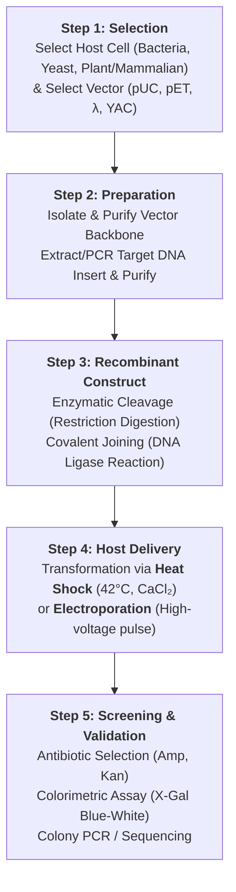

# Chapter 3: Vectors and Cloning

## Course Outline & Syllabus Context
- **Course**: Gene Technology (Công nghệ gen)
- **Chapter**: Chapter 3 - Vectors and Cloning

---

## Chapter 3 Table of Contents
1. **Section I**: Introduction (Clone & Cloning Concepts)
2. **Section II**: Vectors
3. **Section III**: Enzymes in Cloning
4. **Section IV**: Cloning Process

---

## I. Introduction to Cloning

### 1. Concepts & Definitions
- **Clone (Dòng)**: Any biological material (DNA fragment, molecule, cell, or whole organism) that is genetically identical to the original source from which it originated.
  - *Examples*:
    - **Molecular level**: Recombinant human insulin, identical DNA copies.
    - **Cellular level**: Monoclonal cell lines, bacterial colonies derived from a single parent cell.
    - **Organismal level**: Cloned plants (micropropagation / tissue culture in carrots), cloned animals (e.g., Dolly the sheep).
- **Cloning (Kỹ thuật tạo dòng - KT tạo dòng)**: The experimental technique and laboratory process used to produce genetically identical copies of a specific DNA fragment, cell, or organism.

### 2. Levels of Cloning
Cloning applies across three hierarchical biological levels:
1. **Molecular Cloning**:
   - Isolating and producing identical copies of a specific DNA sequence or molecule.
   - Typically propagated within a biological host organism (e.g., *E. coli*).
2. **Cellular Cloning**:
   - Producing a population of genetically identical cells (clones) derived from a single progenitor cell.
   - Forms the basis of cell line maintenance, monoclonal antibody generation, and single-colony isolation.
3. **Organismal Cloning**:
   - Generating an entire multicellular organism that is genetically identical to another donor organism.
   - *Plants*: Somatic embryogenesis, tissue culture propagation (e.g., cloning carrots).
   - *Animals*: Somatic cell nuclear transfer (SCNT) (e.g., Dolly the sheep).

### 3. Purpose, Significance & Applications of Cloning
- **Primary Objectives**:
  - **Desired Characteristics**: Introducing novel metabolic traits, resistance phenotypes, or optimized sequences.
  - **Large Amount (Mass Production)**: Amplifying low-abundance genes or harvesting massive quantities of biopharmaceuticals.
  - **In Control (Regulated Expression)**: Precision timing and inducible regulation of gene transcription and protein synthesis.
- **Major Fields of Application**:
  - **Medicine**: Biopharmaceutical manufacturing (e.g., recombinant human insulin synthesized by transgenic bacteria harboring cloned insulin cDNA), gene therapy, molecular diagnostics.
  - **Research**: Functional genomics, promoter analysis, protein crystallization, mutagenesis studies.
  - **Agriculture**: Transgenic crops with herbicide/pest resistance (e.g., Bt-crops), drought tolerance, enhanced nutritional value.
  - **Industry**: Industrial biotechnology, recombinant enzymes (detergent proteases, amylases), biofuel production.

### 4. Basic Components of a Cloning System
A complete recombinant DNA cloning setup necessitates four foundational components:
1. **Vector**: Carrier DNA vehicle capable of autonomous replication and harboring foreign inserts.
2. **Enzymes**: Molecular tools including:
   - **Restriction Endonucleases (RE)**: Cleave DNA sequences at specific recognition sites.
   - **DNA Ligase**: Catalyzes phosphodiester bond formation between vector and insert ends.
   - Supplementary modifying enzymes (phosphatases, kinases, polymerases).
3. **Recombinant DNA Molecule**:
   - The hybrid construct consisting of vector DNA covalently joined with target DNA of interest (derived via PCR amplification, cDNA synthesis, or genomic digestion).
4. **Host Cell**:
   - Competent biological system (*E. coli*, *Saccharomyces cerevisiae*, insect, or mammalian lines) providing the enzymatic and ribosomal machinery to replicate the vector and translate encoded proteins.

---

## II. Vectors

### 1. Vector Definition & Core Architecture
- **Cloning Vector**: A self-replicating DNA molecule utilized as a vehicle to artificially carry foreign genetic material into a host cell for propagation, manipulation, or expression.

### 2. Four Essential Architectural Features of Cloning Vectors
Every functional cloning vector must possess four primary structural elements:
1. **Origin of Replication (`ori`)**:
   - A distinct nucleotide sequence recognized by host replication enzymes.
   - Enables independent, autonomous replication inside the host cell without relying on host chromosome integration.
   - Dictates plasmid **copy number** (e.g., low-copy vs. high-copy plasmids).
2. **Selectable Marker Genes**:
   - Genetic determinants (predominantly antibiotic resistance genes such as Ampicillin resistance $\text{Amp}^R / bla$, Kanamycin resistance $\text{Kan}^R$, or Chloramphenicol resistance $\text{Cm}^R$).
   - Permits phenotypic discrimination: only host cells that successfully take up the vector survive under selective antibiotic pressure.
3. **Multiple Cloning Site (MCS / Polylinker)**:
   - A synthetic short stretch of DNA containing clustered, unique recognition sequences for multiple different restriction endonucleases.
   - Allows target foreign DNA to be inserted at specific orientations without disrupting essential vector domains (`ori` or selectable markers).
4. **Small Physical Size**:
   - Compact size (typically 2 to 10 kb for standard plasmids).
   - *Advantages*: Facilitates easy laboratory manipulation, resistance to mechanical shear forces during isolation, and dramatically elevates transformation efficiency into competent host cells.

### 3. Classification of Vectors
- **By Biological Function**:
  - **Cloning Vectors**: Primarily engineered for insertion, stable maintenance, and high-fidelity amplification of DNA fragments (e.g., pUC19, pBR322).
  - **Expression Vectors**: Engineered with transcriptional and translational control elements (promoter, ribosomal binding site / Shine-Dalgarno sequence, transcription terminator) to produce recombinant RNA and proteins in specific host systems (e.g., pET series, pGEX).
- **By Vector Backbone / Source**:
  - **Plasmids**: Double-stranded, circular extrachromosomal DNA elements (most ubiquitous).
  - **Bacteriophage Vectors**: Modified viral genomes (e.g., Phage $\lambda$, M13) for cloning larger inserts or producing single-stranded DNA.
  - **Artificial Chromosomes**: Engineered for extremely large DNA fragments (e.g., YACs - Yeast Artificial Chromosomes, BACs - Bacterial Artificial Chromosomes, PACs).

---

### 4. Plasmid Vectors (II.1)

#### A. Biology of Natural Bacterial Plasmids
- **Structure**: Small, circular, covalently closed double-stranded DNA (cc-dsDNA) molecules maintained extrachromosomally in bacteria.
- **Autonomous Replication**: Pertains an autonomous origin of replication (`ori`), enabling replication uncoupled from the bacterial host chromosome.
- **Copy Number**: Ranges naturally from low (1–5 copies/cell) to moderate/high (20–100+ copies/cell).
- **Physiological Functions**: Carries accessory non-essential genes providing selective evolutionary advantages (e.g., antibiotic resistance, heavy metal detox, bacteriocins, conjugative transfer factors).

#### B. Evolutionary Generations of Plasmid Vectors

| Feature | 1st Generation: **pSC101** | 2nd Generation: **pBR322** | 3rd Generation: **pUC series (pUC18 / pUC19)** |
| :--- | :--- | :--- | :--- |
| **Year & Developers** | 1973 (Herbert Boyer & Stanley Cohen) | 1977 (Bolivar & Rodriguez) | 1982+ (Vieira & Messing) |
| **Size / Length** | Large (~9.0 kb) | Medium (4,361 bp) | Small (~2.68 kb) |
| **Copy Number** | Very Low (~1–5 copies/cell) | Moderate (~15–20 copies/cell) | Ultra-High (~500+ copies/cell) |
| **Selectable Markers**| Tetracycline resistance ($\text{Tet}^R$) | Dual: $\text{Tet}^R$ + Ampicillin ($\text{Amp}^R$) | Ampicillin resistance ($\text{Amp}^R$) |
| **Cloning Sites** | Single RE site (*EcoRI*) | Multiple individual RE sites (*BamHI, SalI, HindIII, PstI, EcoRI, EcoRV, NdeI*) | Clustered **Multiple Cloning Site (MCS / Polylinker)** |
| **Screening Strategy** | Antibiotic selection only | **Insertional Inactivation** via tedious replica plating | **Blue-White Colony Screening** via $\alpha$-complementation of *lacZ* |
| **Primary Limitation** | Low yield, large size, minimal RE flexibility | Labor-intensive screening; dual-replica plating required | Insert size limited compared to phage/cosmids (<10 kb) |

#### C. The Blue-White Selection Mechanism (*lacZ* Inactivation)
Third-generation vectors like **pUC19** utilize **$\alpha$-complementation** of the $\beta$-galactosidase enzyme for one-step visual screening on agar containing **Ampicillin + X-Gal + IPTG**:

1. **Host Strain**: Possesses a mutant $\beta$-galactosidase gene deficient in the N-terminal $\alpha$-peptide domain ($\Delta M15$ deletion, producing inactive $\omega$-peptide).
2. **Vector Function**: Carries the regulatory promoter and the $lacZ\alpha$ coding sequence. In an intact vector, the synthesized $\alpha$-peptide binds the host's $\omega$-peptide to reconstitute active tetrameric $\beta$-galactosidase (**$\alpha$-complementation**).
3. **Screening Phenotypes**:
   - **Vector Religation (Non-recombinant / Empty Vector)**:
     - $lacZ\alpha$ sequence is intact.
     - Active $\beta$-galactosidase cleaves chromogenic substrate **X-Gal** (5-bromo-4-chloro-3-indolyl-$\beta$-D-galactopyranoside) yielding an insoluble blue 5,5'-dibromo-4,4'-dichloro-indigo precipitate $\to$ **BLUE COLONIES**.
   - **Recombinant Vector (Insert Ligation / Positive Clone)**:
     - Foreign DNA is ligated into the MCS, disrupting the open reading frame of $lacZ\alpha$ (**insertional inactivation**).
     - No functional $\alpha$-peptide produced; $\alpha$-complementation fails $\to$ **WHITE COLONIES**.
   - **Insert Self-Ligation (No Vector Uptake)**:
     - Lacks the $\text{Amp}^R$ ($bla$) gene $\to$ **NO GROWTH** on ampicillin plates.

#### D. Expression Vectors (e.g., pET System)
- **Role**: Designed not just to maintain/amplify DNA, but to achieve high-level transcriptional and translational expression of target recombinant proteins.
- **Key Expression Elements** (e.g., **pET-19b**, 5,717 bp):
  - **Bacteriophage T7 Promoter**: Highly potent promoter specifically recognized by T7 RNA polymerase (from host genome, e.g., *E. coli* BL21(DE3)).
  - **lac Operator (`lacO`)**: Provides stringent inducible control via IPTG (isopropyl $\beta$-D-1-thiogalactopyranoside).
  - **Affinity Tags (e.g., 10xHis-tag)**: Encodes an N-terminal polyhistidine tag for one-step immobilized metal affinity chromatography (IMAC, $\text{Ni}^{2+}$-NTA).
  - **Protease Cleavage Site (e.g., Enterokinase site)**: Enables enzymatic removal of the affinity tag post-purification.
  - **T7 Terminator**: Halts transcription cleanly to avoid read-through and plasmid instability.
  - **Repressor Gene (`lacI`)**: Encodes the Lac repressor protein to prevent basal leaky expression in the uninduced state.

---

### 5. Bacteriophage Vectors (II.2)
- **Bacteriophage Biology**: Obligate intracellular viruses that naturally infect bacterial cells by binding to outer receptors and injecting viral genomic DNA/RNA through their core/sheath.
- **Lambda ($\lambda$) Phage Vector Architecture & Mechanism**:
  - Wild-type $\lambda$ genome is a 45–48.5 kbp linear dsDNA with cohesive ends (**$\cos$ sites**).
  - **Dispensable Region**: The central ~15–20 kbp segment (lysogeny cassette) is non-essential for lytic replication and plaque formation.
  - **Replacement Vector Pipeline**:
    1. Restriction digestion (e.g., *EcoRI*) cleaves out the non-essential central fragment.
    2. Left arm and right arm contain all structural, replication, and packaging genes, but when isolated together (~30 kb), they are physically too small to be packaged into capsids (<38 kb limit).
    3. Target foreign DNA (e.g., eukaryotic genomic fragments of 10–23 kb) is ligated between the left and right arms.
    4. **In Vitro Packaging**: Recombinant concatemers within the allowable size window (38–52 kbp, ~78%–105% of wild-type) are assembled into bacteriophage heads using packaging extracts.
    5. **Transduction / Infection**: Packaged phages infect *E. coli* lawn with near 100% efficiency, creating clear lytic plaques (**plaque forming units - PFU**).
- **Key Advantages**:
  - Extremely high uptake efficiency compared to calcium-chloride chemical transformation of plasmids.
  - Substantially larger cloning capacity: inserts up to **23 kb**.
  - Rapid viral replication cycles within host cultures.

---

### 6. Yeast Artificial Chromosomes (YACs) (II.3)
- **Concept & Scale**: Linear artificial vectors designed to clone mega-base eukaryotic DNA fragments (typically **100 kb up to 1000 kb / 1 Mb**) in eukaryotic host *Saccharomyces cerevisiae*.
- **Three Essential Cis-Acting Chromosomal Elements**:
  1. **$2 \times$ TEL (Telomeres)**: Sequences that form protective terminal loops, stabilizing chromosome ends against cellular exonuclease degradation and end-replication loss.
  2. **$1 \times$ CEN (Centromere, e.g., CEN4)**: Provides the kinetochore assembly site for spindle attachment, ensuring stable and equal mitotic and meiotic chromosome segregation.
  3. **$1 \times$ ARS (Autonomously Replicating Sequence)**: The yeast eukaryotic origin of replication for autonomous DNA synthesis initiation.
- **YAC Architecture & Cloning Protocol (e.g., pYAC3)**:
  - Maintained circularly in *E. coli* with standard bacterial `ori` and selectable marker.
  - Contains dual yeast auxotrophic selectable markers: **$TRP1$** (tryptophan synthesis) and **$URA3$** (uracil synthesis), flanked by an internal **$SUP4$** gene containing a unique cloning site (e.g., *SnaBI*).
  - Cleavage with *BamHI* releases the internal spacer and exposes the two functional telomeric ends (**TEL**).
  - Cleavage with *SnaBI* splits the vector into:
    - **Left Arm**: `TEL - TRP1 - CEN4 - ARS (ori)`
    - **Right Arm**: `URA3 - TEL`
  - High-molecular-weight target DNA (>100 kb) is ligated between the left and right arms.
  - Functional linear artificial chromosomes transform into yeast spheroplasts; selected on dual dropout media (-Trp, -Ura).

---

## III. Enzymes in Cloning
Recombinant DNA construction depends on two primary catalytic enzyme categories:
1. **Section III.1**: Restriction Endonucleases (Molecular Scissors)
2. **Section III.2**: DNA Ligases (Molecular Glue)

---

### 1. Restriction Enzymes / Restriction Endonucleases (III.1)

#### A. Definition & Catalytic Action
- **Restriction Endonuclease (RE)**: A sequence-specific endodeoxyribonuclease that recognizes a defined nucleotide sequence and cleaves phosphodiester bonds on both strands of the DNA duplex.
- **Biochemical Mechanism**:
  - Cleaves covalent **phosphodiester bonds** within the DNA sugar-phosphate backbone.
  - Disrupts adjacent **hydrogen bonds** between complementary base pairs in staggered cuts, generating free ends.
  - Typically requires divalent cations ($\text{Mg}^{2+}$) as cofactors for phosphodiester hydrolysis.

#### B. Natural Biological Role: The Bacterial "Immune System"
- **Why termed "Restriction"?**: These enzymes were originally discovered because they *restricted* the host range of bacteriophages infecting bacterial strains.
- **The Restriction-Modification (R-M) System**:
  1. **Foreign Phage Invasion**: When unmethylated bacteriophage DNA enters the bacterial cytoplasm, bacterial restriction endonucleases recognize specific palindromic motifs, introducing double-strand breaks. Cellular exonucleases rapidly degrade the fragmented viral DNA into mononucleotides.
  2. **Self-Genome Protection (Methylation)**: The host bacterium expresses a cognate **DNA methyltransferase (methylase, e.g., EcoRI methylase)**. The methylase transfers methyl groups ($\text{-CH}_3$) from $S$-adenosylmethionine (SAM) to specific adenine (N6) or cytosine (C5/N4) bases within the host's recognition sites.
  3. **Steric Hindrance**: Methylation sterically prevents the restriction enzyme from binding and hydrolyzing host chromosomal DNA while leaving unmodified incoming viral DNA vulnerable to cleavage.

#### C. Recognition Sequences & Mathematical Distribution
- **Palindromic Symmetry**: Most type II restriction enzymes recognize continuous **palindromic sequences** possessing twofold rotational symmetry ($C_2$ symmetry):
  $$\text{The sequence reads identical in the } 5' \to 3' \text{ direction on both strands.}$$
- **Common Recognition Lengths**:
  - **4-bp cutters** (e.g., *HaeIII*: $5'\text{-GGCC-}3'$): Cut frequency $= (1/4)^4 = 1/256 \text{ bp}$.
  - **6-bp cutters** (e.g., *EcoRV*: $5'\text{-GATATC-}3'$, *PstI*: $5'\text{-CTGCAG-}3'$): Cut frequency $= (1/4)^6 = 1/4,096 \text{ bp} \approx 4 \text{ kb}$. Ideal for plasmid cloning and gene mapping.
  - **8-bp cutters (Rare Cutters)** (e.g., *NotI*: $5'\text{-GCGGCCGC-}3'$): Cut frequency $= (1/4)^8 = 1/65,536 \text{ bp} \approx 65.5 \text{ kb}$. Used for megabase genomic mapping and YAC cloning.

#### D. Types of Cleavage Termini (End Architectures)
Restriction digestions produce two distinct types of DNA termini:
1. **Sticky / Cohesive Ends (Đầu dính)**:
   - Asymmetric (staggered) cleavage producing transient single-stranded overhangs ($5'$ or $3'$ overhangs).
   - *Example*: **HindIII**:
     $$5'\text{-A}\;|\;\text{AGCTT-}3'$$
     $$3'\text{-TTCGA}\;|\;\text{A-}5'$$
     $\to$ Produces $5'\text{-AGCT}$ protruding single-stranded extensions that spontaneously base-pair via hydrogen bonds with complementary ends, dramatically boosting ligation efficiency.
2. **Blunt Ends (Đầu bằng)**:
   - Symmetrical cleavage across the axis of symmetry, leaving no unpaired single-stranded overhangs.
   - *Example*: **EcoRV**:
     $$5'\text{-GAT}\;|\;\text{ATC-}3'$$
     $$3'\text{-CTA}\;|\;\text{TAG-}5'$$
     $\to$ Termini are fully base-paired; compatible with any other blunt-ended fragment, but ligation efficiency is significantly lower than sticky ends.

#### E. Standardized RE Nomenclature Rules
Restriction enzymes are systematically named according to the binomial nomenclature of their bacterial source organism:
1. **First letter**: Genus of the donor microorganism (capitalized, italicized).
2. **Second and third letters**: Specific epithet (species) (lowercase, italicized).
3. **Fourth letter**: Strain or serotype designation (non-italicized).
4. **Roman numeral**: Order of characterization/isolation in that specific strain.

| Enzyme | Microorganism Source | Strain / Type | Isolation Order |
| :--- | :--- | :--- | :--- |
| **BamHI** | *Bacillus amyloliquefaciens* | Strain H | I |
| **EcoRI** | *Escherichia coli* | RY13 | I |
| **HindIII**| *Haemophilus influenzae* | Strain Rd | III |
| **NotI** | *Nocardia otitidis-caviarum* | — | I |
| **PstI** | *Providencia stuartii* | — | I |
| **SmaI** | *Serratia marcescens* | — | I |

#### F. Classification of Restriction Endonucleases

| Class | Cleavage Position Relative to Target Site | Recognition Motif Symmetry | Cofactor Requirements | Utility in Genetic Engineering |
| :--- | :--- | :--- | :--- | :--- |
| **Type I** | Cleaves at **random sites distant** (>1,000 bp) from recognition site | Asymmetric (bipartite) | ATP, S-adenosylmethionine (SAM), $\text{Mg}^{2+}$ | **Rarely used**; unpredictable cleavage prevents defined cloning |
| **Type II** | Cleaves at **specific sites within or adjacent** to recognition site | Palindromic (2-fold rotational symmetry) | $\text{Mg}^{2+}$ only (no ATP/SAM required) | **Ubiquitous / Fundamental**; predictable fragments (sticky/blunt) |
| **Type III**| Cleaves at fixed short distance (**20–30 bp downstream**) | Asymmetric non-palindromic | ATP, $\text{Mg}^{2+}$ (stimulated by SAM) | **Limited utility**; occasionally used in specialized tagging |

#### G. Enzymatic Activity & Unit Definition
- **Standard Unit Definition ($1\text{ U}$)**:
  - The quantity of restriction endonuclease enzyme required to completely digest $1\text{ }\mu\text{g}$ of reference substrate DNA (commonly bacteriophage $\lambda\text{ DNA}$ or reference plasmid) within **1 hour** at the enzyme's optimal reaction temperature (typically $37^\circ\text{C}$) in a standardized buffer reaction volume (typically $50\text{ }\mu\text{L}$).
  - *Reference Formulation (EcoRI - NEB)*:
    - $1\times\text{ NEBuffer EcoRI}$: $100\text{ mM Tris-HCl}$, $50\text{ mM NaCl}$, $10\text{ mM MgCl}_2$, $\text{pH } 7.5$.
- **Enzyme Inactivation**:
  - **Why Inactivate?**:
    - Uninactivated restriction endonucleases will continue digesting DNA during subsequent steps, destroying the sticky overhangs created for cloning, or cleaving newly circularized recombinant plasmids when DNA ligase is added.
  - **How to Inactivate?**:
    - **Thermal Inactivation**: Incubation at $65^\circ\text{C}$ or $80^\circ\text{C}$ for 20 minutes (effective for heat-labile enzymes like *EcoRI* and *BamHI*).
    - **Chelation**: Addition of EDTA (e.g., 10–20 mM) to chelate essential divalent $\text{Mg}^{2+}$ cofactors.
    - **Purification**: Silica spin-column chromatography or phenol-chloroform extraction for heat-resistant (thermostable) restriction enzymes.

#### H. Critical Criteria for Selecting Restriction Enzymes in Cloning
When designing a molecular cloning strategy, restriction enzymes must fulfill four cardinal rules:
1. **Enzyme Class**: Must strictly be **Type II** for sequence-specific, deterministic cleavage.
2. **Recognition Site in Vector**:
   - Must be localized within the **Multiple Cloning Site (MCS)**.
   - Must be **unique (single-cutter)** across the entire vector backbone so that digestion linearizes the plasmid rather than fragmenting it.
3. **Absence within Insert DNA Sequence**:
   - The chosen enzyme's recognition sequence must **NOT** occur within the open reading frame (ORF) or functional promoter region of the target gene, otherwise the insert will be cleaved internally and inactivated.
4. **Facile Inactivation**:
   - Ideally choose an enzyme that is **heat-inactivatable** ($65^\circ\text{C}$ or $80^\circ\text{C}$ for 20 min) to avoid tedious silica column cleanup prior to adding DNA ligase.

---

### 2. Ligation Enzymes / DNA Ligases (III.2)

#### A. In Vivo Biological Function
- **DNA Replication**: Covalently seals the discontinuous **Okazaki fragments** on the lagging strand by forming phosphodiester bonds between adjacent 3'-OH and 5'-phosphate termini after RNA primer excision and gap-filling by DNA Polymerase.
- **DNA Repair**: Joins single-strand nicks and double-strand breaks during nucleotide excision repair, base excision repair, and recombination.

#### B. In Vitro DNA Ligases in Recombinant Technology
First isolated in 1967 from *E. coli*. Two primary types utilized in genetic engineering:

| Feature | ***E. coli* DNA Ligase** | **Bacteriophage T4 DNA Ligase** |
| :--- | :--- | :--- |
| **Origin / Source** | Bacterial (*E. coli*) | Bacteriophage T4 (Gene 30) |
| **Energy Cofactor** | **$\text{NAD}^+$** (Nicotinamide adenine dinucleotide) | **$\text{ATP}$** (Adenosine triphosphate) + $\text{Mg}^{2+}$ |
| **Substrate Specificity**| **Sticky / Cohesive ends only** | **Both sticky ends and blunt ends** (plus RNA-DNA duplexes) |
| **Ligation Kinetics** | Fast for cohesive ends; inactive on blunt ends | Sticky ends ligate rapidly; blunt ends require higher enzyme conc. & PEG |
| **Commercial Dominance**| Specialized applications | **Standard molecular biology workhorse** |

- **Industrial Production of T4 Ligase**:
  - The bacteriophage T4 gene 30 is cloned into a high-copy expression plasmid, transformed into *E. coli*, overexpressed via inducible promoters, and purified chromatographically.
- **Unit Definition of DNA Ligase ($1\text{ U}$ - Sigma-Aldrich)**:
  - The quantity of enzyme required to ligate **50% of 100 ng** of DNA fragments with cohesive termini in a $50\text{ }\mu\text{L}$ reaction containing $1\times\text{ DNA Ligase Buffer}$ within **30 minutes at $23^\circ\text{C}$**.

## IV. The Cloning Process

### 1. The Step-by-Step Cloning Pipeline
The molecular cloning protocol proceeds through five synchronized phases:



#### Detailed Phase Breakdown:
1. **Phase 1: Selection of Host & Vector System**:
   - *Host Strain*: Non-pathogenic laboratory strains (e.g., *E. coli* DH5$\alpha$, TOP10 for cloning; BL21(DE3) for protein expression).
   - *Vector Selection*: Dictated by insert length, downstream application (expression vs. maintenance), and available restriction sites.
2. **Phase 2: Preparation of Vector and Insert**:
   - **Vector DNA**: Isolated via alkaline lysis / silica miniprep, checked for purity ($A_{260}/A_{280} \approx 1.8$).
   - **Target Insert**: Generated by PCR amplification using primers containing flanking restriction recognition sequences, cDNA synthesis, or genomic fragmentation, followed by spin-column purification to remove primers and enzymes.
3. **Phase 3: Generation of Recombinant DNA**:
   - Simultaneous or sequential digestion with compatible restriction endonucleases (or single-enzyme digest).
   - Optional: 5'-dephosphorylation of linearized vector using **Alkaline Phosphatase** (CIP / SAP) to suppress empty vector self-ligation.
   - Incubation with **T4 DNA Ligase** in ATP-supplemented buffer at $16^\circ\text{C}$ overnight or $22^\circ\text{C}$ for 1–2 hours at an optimized vector:insert molar ratio (typically 1:3 or 1:5).
4. **Phase 4: Transformation into Competent Host Cells**:
   - **Chemical Transformation (Heat Shock)**:
     - Chemically competent cells treated with divalent ice-cold $\text{CaCl}_2$ (shields negatively charged DNA and membrane phospholipids).
     - Rapid thermal pulse at **$42^\circ\text{C}$ for 45–90 seconds** creates transient lipid bilayer pores, enabling DNA entry, followed by immediate chilling on ice.
   - **Electroporation**:
     - Electrocompetent cells in non-ionic glycerol/water subjected to a brief high-voltage electrical field (1.8–2.5 kV) creating temporary membrane electropores; yields $10^9$ to $10^{10} \text{ cfu}/\mu\text{g}$ efficiency.
   - **Outgrowth / Recovery**: Incubation in rich SOC/LB media without antibiotic at $37^\circ\text{C}$ for 45–60 min allows phenotypic expression of antibiotic resistance proteins prior to selective plating.
5. **Phase 5: Screening, Verification, and Scale-up**:
   - Plated on selective agar containing antibiotics ($\text{Amp}$, $\text{Kan}$, $\text{Tet}$) and chromogenic inducers (IPTG + X-Gal).
   - Selected single recombinant colonies inoculated into liquid media for mass plasmid propagation (clone expansion).
   - Miniprep extraction followed by analytical diagnostic digest and Sanger sequencing.

---

### 2. Concrete Example: Cohesive-End Cloning (*EcoRI*)
1. **Vector**: Plasmid carrying an ampicillin resistance gene ($bla$) and a unique *EcoRI* cleavage site ($5'\text{-G}\downarrow\text{AATTC-}3'$).
2. **Target Fragment**: Foreign genomic DNA cleaved with *EcoRI*, producing complementary $5'\text{-AATT}$ overhangs.
3. **Ligation**: Hydrogen bonding anneals matching sticky ends, followed by T4 DNA ligase catalyzing phosphodiester bonds to form circular recombinant plasmids.
4. **Plating**: Transformed *E. coli* cells spread onto ampicillin agar plates.
   - *Untransformed host cells*: Susceptible to ampicillin $\to$ kill / no growth.
   - *Transformants*: Possess plasmid $\to$ proliferate into colonies.
5. **Downstream**: Colonies expanded in liquid broth $\to$ cells harvested $\to$ recombinant plasmids purified for downstream applications.

---

### 3. TA Cloning (Cloning of PCR Products)

#### A. Molecular Principle
- **Terminal Transferase Activity of *Taq***:
  - Standard *Thermus aquaticus* (*Taq*) DNA Polymerase possesses non-template-dependent terminal transferase activity.
  - Catalyzes the preferential addition of a single extra deoxyadenosine (**$3'\text{-A}$ overhang**) to both $3'$ hydroxyl termini of blunt-ended double-stranded PCR amplicons.
- **Linearized T-Vectors**:
  - Commercially engineered plasmid vectors linearized and enzymatic-treated to display a single protruding deoxythymidine (**$3'\text{-T}$ overhang**) on both ends (e.g., pGEM-T Easy, pCR2.1).
- **Ligation Mechanism**:
  - The complementary $3'\text{-A}$ on the PCR product and $3'\text{-T}$ on the vector undergo base-pairing, enabling efficient covalent ligation by T4 DNA ligase without requiring restriction enzyme digestion.

```
PCR Product:  5'---------------------------A-3'
              3'-A---------------------------5'
                          +
Linear T-Vector:
              3'-T---------------------------5'
              5'---------------------------T-3'
```

#### B. Comparative Analysis: Advantages vs. Disadvantages

| Parameters | Advantages of TA Cloning | Disadvantages / Limitations |
| :--- | :--- | :--- |
| **Enzyme Necessity** | **No restriction enzymes needed**; completely circumvents RE digest | **Dependent on non-proofreading polymerase** (*Taq*); proofreading enzymes (*Pfu, Q5*) have $3' \to 5'$ exonuclease activity yielding blunt ends (requires separate post-PCR A-tailing) |
| **Primer Design** | No need to append 6–8 bp restriction sites or protective flanking bases to primers | **Non-directional insertion**: Insert ligates randomly in forward ($5' \to 3'$) or reverse ($3' \to 5'$) orientation (50% probability each) |
| **Protocol Speed** | Direct, rapid ligation immediately following PCR amplification | **Commercial T-vectors are expensive**; cannot directly control in-frame fusion for expression without downstream orientation screening |

---

## V. Chapter Summary & Comparative Synthesis

### 1. Vector System Comparison Matrix

| Vector System | Host Organism | Typical Insert Capacity | Dominant Replication Mode | Primary Application |
| :--- | :--- | :--- | :--- | :--- |
| **Standard Plasmid (pUC)** | *E. coli* | $0.1 - 10\text{ kb}$ | High-copy circular episome | Subcloning, sequencing, PCR storage |
| **Expression Plasmid (pET)** | *E. coli* (DE3) | $0.5 - 5\text{ kb}$ | Inducible T7 promoter plasmid | High-yield recombinant protein production |
| **Bacteriophage Lambda ($\lambda$)** | *E. coli* | $9 - 23\text{ kb}$ | Lytic virion infection / packaging | Genomic DNA libraries, cDNA libraries |
| **YAC (Yeast Artificial Chromosome)** | *S. cerevisiae* | $100 - 1000\text{ kb}$ ($1\text{ Mb}$) | Linear eukaryotic chromosome (ARS/CEN/TEL) | Large-scale eukaryotic genomic mapping |

---

## VI. Cross-References & Related Vault Notes
- [[Chapter 1 - Nucleic Acids Extraction and Purification]] - Methods for isolating template genomic DNA and plasmids.
- [[Chapter 2 - PCR and Electrophoresis]] - Amplicon generation, *Taq* polymerases, and agarose gel resolution of digested vectors.
- [[Chapter 4 - Blotting Methods]] - Downstream detection and hybrid confirmation of cloned targets.
- [[Chapter 6 - Gene Transfer in Microorganisms]] - Comprehensive mechanisms of transformation, electroporation, and transfection.


