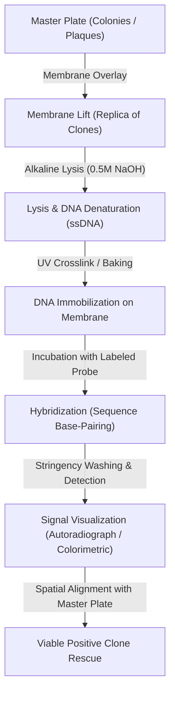

# Chapter 4: Blotting Methods

## Course Outline & Syllabus Context
- **Course**: Gene Technology (Công nghệ gen)
- **Chapter**: Chapter 4 - Blotting Methods (Các phương pháp lai / thấm tách phân tử)
- **Related Course Modules**:
  - [[Chapter 1 - Nucleic Acids Extraction and Purification]] (Isolation & quality evaluation of target DNA/RNA)
  - [[Chapter 2 - PCR and Electrophoresis]] (Gel matrix separation & comparative nucleic acid amplification)
  - [[Chapter 3 - Vectors and Cloning]] (Recombinant constructs, restriction mapping & clone propagation)

---

## Chapter 4 Table of Contents
1. **Section I**: Introduction to Blotting & Nucleic Acid Hybridization
2. **Section II**: Southern Blotting
3. **Section III**: Northern Blotting
4. **Section IV**: Comparative Analysis (Southern vs. Northern vs. PCR)
5. **Section V**: In Situ Hybridization (ISH) & Colony/Plaque Hybridization
6. **Section VI**: In-Depth Case Study: Phage-Based Colorimetric Biosensor for Pathogen Detection
7. **Section VII**: Master Summary: Comparison of Core Blotting & Hybridization Techniques
8. **Section VIII**: High-Yield Exam Review Points & Conceptual Takeaways

---

## I. Introduction to Blotting Methods

### 1. Definition & Fundamental Principle
- **Blotting Methods (Kỹ thuật thấm / Kỹ thuật lai phân tử)**: A suite of molecular biology analytical techniques used to identify, detect, and quantify specific target biomolecules (DNA, RNA, or proteins) from complex biological mixtures after physical separation by gel electrophoresis.
- **Underlying Concept**:
  - Macromolecules are initially resolved by size, charge, or conformation within a porous gel matrix (agarose or polyacrylamide).
  - Because gels are fragile, diffuse rapidly, and are impermeable to large hybridization probes or antibodies, the resolved biomolecules are immobilized by transfer (blotting) onto the surface of a solid, durable membrane (e.g., nitrocellulose, nylon, or PVDF).
  - Target molecules are subsequently probed using complementary nucleic acid sequences (DNA/RNA probes) or specific affinity ligands (antibodies).

### 2. Molecular Hybridization Fundamentals
- **Nucleic Acid Hybridization (Sự lai acid nucleic)**: The spontaneous annealing of single-stranded nucleic acid chains to form double-stranded hybrid duplexes via Watson-Crick hydrogen bonding between complementary base pairs.
- **Interactions**:
  - **DNA–DNA Hybridization**: Double-stranded DNA denatures upon thermal or alkaline denaturation ($\text{dsDNA} \rightarrow \text{ssDNA}$); addition of a labeled complementary ssDNA probe allows specific re-annealing.
  - **RNA–DNA Hybridization**: Single-stranded RNA pairs with single-stranded DNA probes or vice-versa. In RNA–DNA heteroduplexes, Uracil ($\text{U}$) in RNA is functionally and structurally equivalent to Thymine ($\text{T}$) in DNA, base-pairing with Adenine ($\text{A}$).
- **Probe Concept (Mẫu dò)**:
  - A defined, labeled fragment of single-stranded DNA or RNA (typically ranging from oligonucleotide lengths of 20–50 nt to cloned fragments of several hundred to thousands of nucleotides).
  - Labeled with reporter molecules: radioisotopes ($^{32}\text{P}$, $^{35}\text{S}$, $^{3}\text{H}$), fluorophores, or enzymatic/antigenic tags (digoxigenin - DIG, biotin).
  - Provides extreme specificity and high sensitivity for locating target sequences within vast background genomic populations.

---

## II. Southern Blotting

### 1. Overview & Historical Background
- **Discovery**: Developed in 1975 by British biologist **Edwin Mellor Southern**.
- **Purpose**: Specific detection, identification, sizing, and quantification of target DNA fragments within complex genomic DNA or recombinant constructs.
- **Core Principles**:
  1. **Quantified DNA**: Genomic or plasmid DNA must be precisely extracted and quantified prior to digestion.
  2. **Denatured DNA**: Target double-stranded DNA must be fully denatured into single strands ($\text{ssDNA}$) to expose nucleotide bases for base pairing.
  3. **DNA–DNA Hybridization**: Specific pairing between immobilized single-stranded target DNA on a membrane and a complementary labeled probe.

### 2. Standard Southern Blotting Workflow
The Southern blot follows six sequential biochemical steps:

1. **DNA Extraction & Restriction Digestion**:
   - High-molecular-weight genomic DNA containing the target sequence is isolated from donor cells.
   - Cleaved into reproducible, discrete fragments using sequence-specific **Restriction Endonucleases (RE)**.
2. **Agarose Gel Electrophoresis**:
   - DNA fragments are size-fractionated across an agarose gel under an electric field.
   - Generates a continuous smear of fragments (for complex genomic DNA) or distinct bands.
   - Staining (e.g., Ethidium Bromide - EtBr) allows visualization under UV transillumination alongside a molecular weight marker.
3. **In-Gel Denaturation & Capillary Transfer (Blotting Setup)**:
   - Gel is soaked in an alkaline denaturation buffer (typically $\text{0.5 M NaOH}, \text{1.5 M NaCl}$) to dissociate double strands into single strands ($\text{ssDNA}$).
   - Neutralized in buffered salt solution (e.g., Tris-HCl / NaCl).
   - **Capillary Transfer Assembly**:
     - Reservoir containing high-salt transfer buffer (standard $10\times$ or $20\times\text{ SSC}$ — Saline-Sodium Citrate: $\text{NaCl} + \text{Na}_3\text{Citrate}$).
     - Support platform / sponge acting as a wick.
     - Agarose gel positioned upside-down or face-up.
     - Solid immobilization membrane (nitrocellulose or positively charged nylon filter) laid in direct, bubble-free contact on top of the gel.
     - Stack of absorbent paper towels topped with a light weight ($0.5 - 1\text{ kg}$) to drive upward capillary flow.
     - Upward liquid movement draws buffer from the reservoir through the gel and membrane. DNA fragments are carried out of the gel and trapped on the membrane surface by electrostatic/hydrophobic interactions.
4. **DNA Immobilization (Fixation)**:
   - Membrane retains an exact spatial replica of the electrophoretic band pattern.
   - DNA is covalently crosslinked or permanently fixed to the matrix:
     - **Nitrocellulose**: Baked under vacuum at $80^\circ\text{C}$ for $1 - 2\text{ hours}$.
     - **Nylon**: Crosslinked via shortwave UV irradiation ($254\text{ nm}$).
5. **Hybridization with Labeled Probe**:
   - Membrane is pre-hybridized (blocking unspecific binding sites with Denhardt's solution, sheared salmon sperm DNA, or SDS).
   - Incubated in a sealable hybridization bag or rotating hybridization tube with a specific single-stranded labeled DNA probe.
   - Probe hybridizes selectively to its complementary sequence on the immobilized target DNA.
6. **Washing & Detection (Visualization)**:
   - Stringency washes with decreasing concentrations of SSC and increasing temperature remove non-specifically bound or mismatched probes.
   - Target fragment is visualized:
     - **Radioactive probes**: Exposed to X-ray film for **autoradiography** or phosphorimaging screens, revealing discrete black bands corresponding strictly to the gene of interest.
     - **Non-radioactive probes**: Chemiluminescent or chromogenic substrates detected via CCD imaging or colorimetric precipitation.

### 3. Key Applications of Southern Blotting
- **Gene Mapping & Identification**: Pinpointing specific gene loci and physical boundaries within unsequenced or sequenced genomes.
- **Structural Variant Detection**: Identifying large genomic insertions, deletions (indels), duplications, translocations, or gene rearrangements.
- **Restriction Fragment Length Polymorphism (RFLP)**: Detecting single-nucleotide polymorphisms (SNPs) or mutations that create or abolish restriction enzyme cleavage sites (crucial in clinical diagnostics, carrier screening, and early forensic DNA profiling).
- **Transgene Verification**: Confirming the integration, orientation, and copy number of foreign gene constructs in transgenic organisms (plants, animals, cell lines).

---

## III. Northern Blotting

### 1. Overview & Historical Background
- **Discovery**: Developed in 1977 by **James Alwine**, **David Kemp**, and **George Stark** at Stanford University (named as a molecular biology pun on Southern's surname).
- **Purpose**: Specific detection, sizing, and quantification of RNA molecules—primarily messenger RNA (**mRNA**) to evaluate gene expression levels and alternative splicing patterns.
- **Core Principles**:
  1. **Quantified RNA**: Total RNA or poly(A)+ mRNA is meticulously extracted, evaluated for integrity (e.g., $28\text{S}:18\text{S rRNA}$ ratio $\ge 2.0$), and quantified spectrophotometrically before loading.
  2. **Denatured RNA**: Unlike dsDNA, single-stranded RNA molecules readily fold into complex intramolecular secondary structures (hairpins, stem-loops). To ensure migration is strictly proportional to molecular weight / length, RNA must be fully denatured before and during electrophoresis.
  3. **RNA–DNA Hybridization**: Formation of stable, sequence-specific heteroduplexes between membrane-immobilized single-stranded RNA and a labeled probe (DNA or antisense RNA).

### 2. Standard Northern Blotting Workflow
1. **RNA Extraction & Quality Control**:
   - Total cellular RNA or purified $\text{poly(A)}^+$ mRNA is extracted under strict RNase-free conditions (utilizing DEPC-treated water, guanidinium thiocyanate, and RNase inhibitors).
2. **Denaturing Agarose Gel Electrophoresis**:
   - RNA is electrophoresed under denaturing conditions—commonly utilizing **formaldehyde/formamide** or **glyoxal/DMSO** gels.
   - *Biochemical Rationale*: Formaldehyde reacts with amino groups of purine/pyrimidine bases to disrupt hydrogen bonding, linearizing the folded RNA molecules.
   - *Crucial Difference from Southern*: Alkaline denaturation ($\text{NaOH}$) **CANNOT** be used for RNA, because hydroxide ions catalyze the nucleophilic attack of the $2'\text{-OH}$ group on the adjacent phosphodiester backbone, rapidly hydrolyzing RNA into mononucleotides!
3. **Capillary / Vacuum Transfer to Membrane**:
   - Linearized RNA is blotted onto a positively charged nylon membrane via capillary salt transfer or vacuum-assisted transfer.
   - Positively charged nylon membranes are strongly preferred over nitrocellulose due to higher binding capacity for RNA, physical durability, and suitability for multiple stripping/re-probing cycles.
4. **Fixation (Immobilization)**:
   - RNA is covalently linked to the membrane matrix via **UV crosslinking** ($254\text{ nm}$ forming covalent thymine/uracil–membrane bonds) or baking at $80^\circ\text{C}$ under vacuum.
5. **Hybridization**:
   - Incubated with radioactively labeled ($^{32}\text{P}$) or hapten-labeled (digoxigenin / biotin) single-stranded complementary DNA (cDNA/oligo) or complementary RNA (cRNA / riboprobe).
6. **Washing & Detection**:
   - High-stringency washing eliminates mismatched hybridizations.
   - Visualized via autoradiography, chemiluminescent imaging, or fluorescence. Band intensity correlates directly with target transcript abundance, while band position indicates transcript size (identifying splice variants).

### 3. Key Applications of Northern Blotting
- **Analysis of Gene Expression Patterns**:
  - Investigating steady-state mRNA abundance across distinct tissues (tissue-specific expression profiling).
  - Temporal gene expression tracking across developmental stages or cell cycle phases.
  - Transcriptional responses to environmental, pharmacological, or physiological stimuli (e.g., stress response, hormone induction).
- **Detection of RNA Viruses**:
  - Qualitative identification and quantitative viral load assessment of positive- or negative-sense single-stranded RNA viruses (e.g., Influenza, Coronaviruses, Retroviruses).
  - Determination of viral subgenomic RNA transcript sizes.
- **Alternative Splicing & Transcript Size Analysis**:
  - Measuring exact physical transcript sizes to uncover novel splicing isoforms, polyadenylation site variations, or premature transcription termination.

---

## IV. Comparative Analysis: Blotting Techniques & Molecular Assays

### 1. Southern Blot vs. Northern Blot
| Parameter | Southern Blotting | Northern Blotting |
| :--- | :--- | :--- |
| **Primary Target Molecule** | DNA (Genomic DNA, plasmid DNA) | RNA (Total RNA, $\text{poly(A)}^+$ mRNA) |
| **Pioneers & Year** | Edwin Southern (1975) | James Alwine, David Kemp, George Stark (1977) |
| **Restriction Enzyme (RE) Digestion** | **Mandatory**: High-MW genomic DNA must be digested into fragments | **None**: Transcripts are naturally discrete, intact molecules |
| **Denaturation Mechanism** | Alkaline buffer ($\text{NaOH / NaCl}$) breaks hydrogen bonds between dsDNA strands | Denaturing gel electrophoresis (formaldehyde or glyoxal) disrupts secondary hairpins |
| **Susceptibility to Alkaline Hydrolysis** | **Resistant**: Lacks $2'\text{-OH}$ group; stable in $\text{NaOH}$ | **Extremely labile**: $2'\text{-OH}$ causes immediate alkaline backbone degradation |
| **Hybridization Duplex** | $\text{DNA–DNA}$ (or $\text{DNA–cRNA}$) | $\text{RNA–DNA}$ (or $\text{RNA–RNA}$) |
| **Membrane Matrix** | Nitrocellulose or Nylon | Positively charged Nylon (nitrocellulose binds RNA poorly) |
| **Primary Biological Output** | Gene copy number, restriction map, gene rearrangements, RFLPs | Gene expression levels, transcript size, alternative splicing |

### 2. Southern & Northern Blotting vs. PCR Technologies
| Feature | Southern / Northern Blotting | Conventional PCR | Real-Time Quantitative PCR (qPCR / RT-qPCR) |
| :--- | :--- | :--- | :--- |
| **Primary Detection Objective** | Physical size + sequence hybridization | Qualitative amplicon presence/absence + size | Absolute or relative target quantification |
| **Input Material Amount** | High ($\mu\text{g}$ quantities of purified DNA/RNA) | Very Low ($\text{pg} - \text{ng}$ range) | Very Low ($\text{pg} - \text{ng}$ range) |
| **Need for Prior Sequence Info** | Low/Moderate (probe sequence needed; flanking regions unneeded) | High (exact primer binding sites on both $5'$ and $3'$ ends required) | High (exact primers + fluorogenic probe sequences required) |
| **Detection of Structural Variations** | Excellent (captures uncharacterized large insertions/deletions, novel splice isoforms) | Poor (primers fail if insertion is too large or binding site deleted) | Poor (designed exclusively for short $70 - 200\text{ bp}$ amplicons) |
| **Turnaround Time & Workflow** | Labor-intensive, multi-day procedure ($2 - 4\text{ days}$) | Fast ($2 - 4\text{ hours}$) | Ultra-fast, high-throughput ($1 - 2\text{ hours}$) |
| **Quantification Accuracy** | Semi-quantitative (densitometry scanning of bands) | Non-quantitative (endpoint plateau bias) | Highly quantitative (broad linear dynamic range $> 7\text{ logs}$) |

---

## V. In Situ Hybridization (ISH) & Colony/Plaque Hybridization

### 1. Concepts & Definition
- **In Situ Hybridization (ISH - Lai tại chỗ)**: A specialized hybridization technique where base-pairing occurs between a labeled nucleic acid probe and its target sequence directly **within fixed tissue sections, cytological cell preparations, or intact colonies/plaques** on culture plates without prior biochemical purification of nucleic acids.
- **Core Advantages**:
  - Preserves topological, histological, and spatial context of gene expression or sequence location.
  - Allows rapid, high-throughput screening of tens of thousands of recombinant clones simultaneously on Petri plates.

---

### 2. Colony Hybridization & Plaque Hybridization Workflow
Colony/plaque hybridization (first developed by Grunstein and Hogness in 1975, and Benton and Davis in 1977) is the gold standard for screening genomic or cDNA libraries to identify clones harboring target inserts.

#### Step-by-Step Procedure:
1. **Replica Plating / Membrane Lift**:
   - Recombinant colonies (bacterial transformants) or plaques (bacteriophage lysates) are grown on agar plates (**Master Plate**).
   - A dry, sterile nitrocellulose or nylon membrane is placed directly onto the agar surface for $1 - 2\text{ minutes}$.
   - Reference points (asymmetric orientation marks) are poked through the membrane into the underlying agar using a sterile needle to ensure precise spatial re-alignment.
   - Part of each colony or plaque adheres to the membrane, forming an exact spatial replica, while viable cells/phages remain unharmed on the master plate.
2. **In Situ Cell Lysis & DNA Denaturation**:
   - The membrane is transferred through a series of filter paper pads saturated with:
     - **Lysis / Alkaline Denaturing Solution** ($\text{0.5 M NaOH}, \text{1.5 M NaCl}$): Dissolves bacterial membranes/phage capsids and denatures double-stranded DNA into single strands ($\text{ssDNA}$).
     - **Neutralizing Solution** ($\text{Tris-HCl}, \text{NaCl}$): Restores neutral pH while maintaining single-stranded state.
     - **High-Salt Washing Solution** ($2\times\text{ SSC}$): Rinses cellular debris while preserving DNA adherence.
3. **DNA Fixation**:
   - DNA is covalently fixed onto the membrane by UV irradiation ($254\text{ nm}$) or vacuum baking ($80^\circ\text{C}$).
4. **Hybridization**:
   - Membrane is blocked against non-specific binding and hybridized with a radioactive ($^{32}\text{P}$) or hapten-labeled (digoxigenin, biotin) probe complementary to the target gene.
5. **Detection & Alignment**:
   - Unbound probe is washed away under controlled stringency conditions.
   - Signal is detected via autoradiography (X-ray film) or chemiluminescence/colorimetry (antibody-conjugated alkaline phosphatase or peroxidase).
   - The developed signal film or membrane is aligned with the reference needle marks on the original master plate.
   - Positive clones are pinpointed, picked from the master plate with a sterile loop or pipette tip, and inoculated for downstream culture and analysis.

---

## VI. In-Depth Case Study: Phage-Based Colorimetric Biosensor for Pathogen Detection

A practical application of in situ molecular biology techniques is the development of engineered bacteriophage biosensors for rapid pathogen detection (e.g., detecting viable *Escherichia coli* K-12 in water or clinical samples).

### 1. Objective & System Architecture
- **Target**: Rapid, specific detection of viable *E. coli* K-12 bacteria.
- **Model Vector**: **Bacteriophage T4** (a well-characterized Myoviridae lytic coliphage with a large $\sim 169\text{ kb}$ dsDNA genome).
- **Reporter Enzyme**: **Cytochrome c Peroxidase (CCP)** from *Saccharomyces cerevisiae*.
- **Assay Rationale**:
  - Wild-type phages kill bacteria without producing an easily quantifiable signal.
  - An engineered recombinant phage (**$\text{T4ccp}$**) carries the eukaryotic *ccp* gene under phage transcriptional control.
  - Infection occurs **only if viable, host-specific *E. coli* are present**.
  - During phage lytic replication, CCP enzyme is synthesized in massive quantities inside the host bacterium.
  - Phage-mediated cell lysis releases intracellular CCP into the surrounding solution.
  - Released CCP catalyzes the oxidation of a chromogenic substrate to yield a distinct colorimetric product (detectable by naked eye or spectrophotometer).

---

### 2. Genetic Engineering of Phage T4 via Homologous Recombination
Because bacteriophage T4 has an enormous genome ($\sim 169\text{ kb}$) containing modified hydroxymethylcytosine bases and is lethal to directly digest and ligate in vitro, direct restriction cloning is impossible. Phage engineering relies on **in vivo homologous recombination**.

#### Phase A: Construction of the Recombination Transfer Vector (`pCRT4ccp`)
1. **Flanking Homologous Arms**:
   - Non-essential locus chosen on T4 genome: between **`g69`** (gene 69) and **`socmrh2`**.
   - `g69` fragment ($\sim 500\text{ bp}$) and `socmrh2` fragment ($\sim 500\text{ bp}$) are amplified by PCR from wild-type T4 genome (`T4wt`).
2. **Reporter Gene**:
   - *ccp* coding sequence is amplified by PCR from the genome of the yeast *Saccharomyces cerevisiae*.
3. **Sequential Assembly into Cloning Vector**:
   - Backbone: **`pCR 2.1-TOPO`** (TA cloning plasmid).
   - Step 1: `g69` fragment is cloned into `pCR 2.1-TOPO` $\rightarrow$ **`pCR 2.1-g69`**.
   - Step 2: `ccp` reporter gene is inserted downstream of `g69` $\rightarrow$ **`pCR 2.1-g69-ccp`**.
   - Step 3: `socmrh2` fragment is inserted downstream of `ccp` $\rightarrow$ **`pCRT4ccp`**.
   - The resulting plasmid contains the complete cassette: **`[g69] – [ccp] – [socmrh2]`**.

#### Phase B: In Vivo Homologous Recombination
1. Host *E. coli* cells are transformed with the transfer plasmid `pCRT4ccp`.
2. The transformed cells are infected with wild-type T4 phage (`T4wt`).
3. As the T4 phage replicates its genomic DNA inside the host, the cellular and phage recombination machinery facilitates double crossover between the homologous flanking arms (`g69` and `socmrh2`) of the plasmid and the phage chromosome.
4. This crossover exchanges the native locus with the `ccp` insertion, yielding recombinant phage genomes (**$\text{T4ccp}$**).
5. Cell lysis yields a mixed phage progeny:
   - **Wild-type phage ($\text{T4wt}$)**: Vast majority ($> 99.9\%$).
   - **Recombinant phage ($\text{T4ccp}$)**: Very rare ($< 0.1\%$).

---

### 3. Isolation of Rare Recombinants via Plaque Hybridization
Because $\text{T4wt}$ and $\text{T4ccp}$ form identical clear lytic plaques on an *E. coli* lawn, phenotypic visual selection is impossible. **Plaque hybridization** provides sequence-level discrimination:

```mermaid
flowchart LR
    A["Plaque Plate (Mixed T4wt + T4ccp)"] -->|"Nylon Lift"| B["Membrane with Phage DNA"]
    B -->|"Alkaline Lysis & Fixation"| C["Denatured ssDNA Membrane"]
    C -->|"Hybridize with ccp Probe"| D["Specific ccp-Probe Binding"]
    D -->|"Antibody Conjugate & Substrate"| E["Dark Signal on Positive Plaque"]
    E -->|"Re-align with Master Plate"| F["Rescue Pure Recombinant T4ccp"]
```

1. **Plating**: Serial dilutions of the mixed phage lysate are plated onto host *E. coli* top agar to form isolated plaques on a Petri dish (**Plaque Plate**).
2. **Membrane Transfer**: A charged **nylon membrane** is placed directly over the plaque-covered agar. Capsid particles and phage DNA in each plaque absorb onto the membrane.
3. **Denaturation & Neutralization**:
   - Soaked in alkaline buffer ($\text{NaOH / NaCl}$) to release and denature phage DNA into single strands.
   - Neutralized and UV-crosslinked.
4. **Hybridization with `ccp`-Specific Probe**:
   - A probe complementary exclusively to the yeast *ccp* sequence is labeled (e.g., with digoxigenin - DIG).
   - Probe hybridizes **only** to spots containing DNA from $\text{T4ccp}$ plaques. Wild-type $\text{T4wt}$ plaques lack the *ccp* sequence and produce zero hybridization signal.
5. **Immunodetection**:
   - Membrane is incubated with anti-DIG antibodies conjugated to alkaline phosphatase (AP) or horseradish peroxidase (HRP).
   - Addition of chromogenic substrate produces localized dark spots corresponding strictly to recombinant clones.
6. **Isolation**:
   - Overlaying the developed membrane on the original plaque plate identifies the single recombinant plaque among thousands of wild-type plaques.
   - Plaque is picked and plaque-purified through 2–3 successive rounds to obtain homogeneous stock of **$\text{T4ccp}$**.

---

## VII. Master Summary: Comparison of Core Blotting & Hybridization Techniques

| Technique | Target Biomolecule | Separation Matrix | Transfer Method | Membrane Material | Probe / Detection Agent | Primary Application |
| :--- | :--- | :--- | :--- | :--- | :--- | :--- |
| **Southern Blot** | **DNA** (dsDNA) | Agarose gel (after RE cleavage) | Capillary (alkaline salt buffer) or vacuum | Nitrocellulose or Nylon | Labeled single-stranded DNA/RNA probe | Gene structure, RFLP, copy number, transgene verification |
| **Northern Blot** | **RNA** (mRNA, viral RNA) | Denaturing agarose (formaldehyde/glyoxal) | Capillary (neutral salt buffer) or vacuum | Positively charged Nylon | Labeled cDNA, cRNA, or antisense oligonucleotide | Gene expression levels, transcript sizing, alternative splicing |
| **Western Blot** | **Protein** | Polyacrylamide gel (SDS-PAGE / Native) | Electroblotting (electric field transfer) | PVDF or Nitrocellulose | Primary & enzyme-conjugated secondary antibodies | Protein expression, post-translational modifications, diagnostic serology |
| **Colony / Plaque Hybridization** | **DNA** (bacterial/phage) | In situ colonies/plaques on agar plate | Direct contact membrane lift | Nitrocellulose or Nylon | Labeled DNA/RNA fragment probe | Library screening, identifying rare recombinant transformants/phages |
| **Fluorescence In Situ Hybridization (FISH)** | **DNA / RNA** (cellular/chromosomal) | Intact cells, metaphase spreads, tissue slices | No transfer (in situ within fixed matrix) | Microscopic glass slide | Fluorophore-conjugated oligonucleotide probes | Chromosome mapping, karyotyping, translocations, spatial transcriptomics |

---

## VIII. Key Exam Review Points & Conceptual Takeaways

1. **Why is RE digestion required for Southern Blotting but omitted in Northern Blotting?**
   - High-molecular-weight genomic DNA is several million to billions of base pairs long; it cannot enter or resolve in an agarose gel without restriction endonuclease cleavage into fragments ($0.5 - 20\text{ kb}$).
   - RNA transcripts are naturally synthesized as discrete, finite-length single-stranded molecules that resolve cleanly by size without enzymatic fragmentation.
2. **Why can $\text{NaOH}$ be used to denature DNA in Southern Blotting but is forbidden in Northern Blotting?**
   - DNA lacks a $2'\text{-OH}$ group on its deoxyribose ring and is chemically stable under alkaline conditions.
   - RNA possesses a reactive $2'\text{-OH}$ hydroxyl group on its ribose ring. Under alkaline conditions ($\text{OH}^-$), the $2'\text{-OH}$ acts as a nucleophile, attacking the adjacent $3',5'\text{-phosphodiester}$ bond, resulting in cyclic $2',3'\text{-phosphate}$ intermediates and catastrophic hydrolytic degradation of RNA into mononucleotides.
3. **What role does stringency play in hybridization assays?**
   - **Stringency** dictates how closely matched probe and target sequences must be to remain base-paired.
   - **High Stringency** (low salt concentration, elevated temperature, presence of formamide) favors only 100% perfectly matched duplexes, minimizing non-specific background.
   - **Low Stringency** (high salt concentration, lower temperature) allows hybridization of partially matched or related gene family members (heterologous probes).
4. **Why is Nylon preferred over Nitrocellulose for Northern and Plaque Hybridization?**
   - Positively charged nylon membranes possess electrostatic affinity for negatively charged nucleic acids, binding short and single-stranded RNA much more efficiently than uncharged nitrocellulose.
   - Nylon is mechanically resilient, does not become brittle upon baking or UV crosslinking, and withstands harsh stripping protocols for repeated re-probing.

