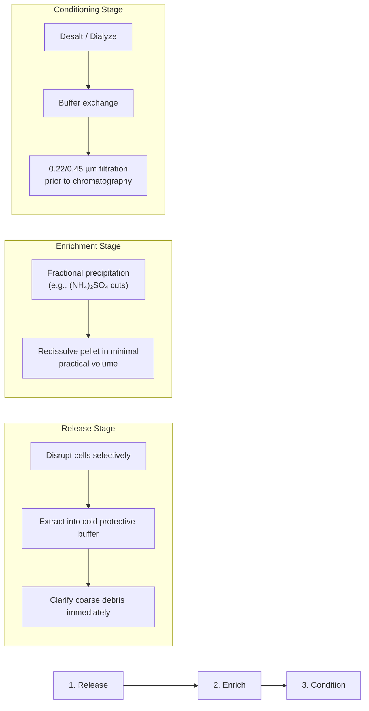
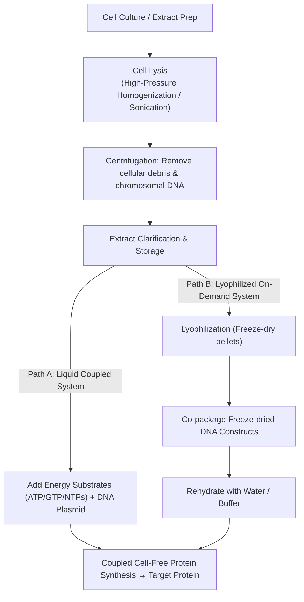
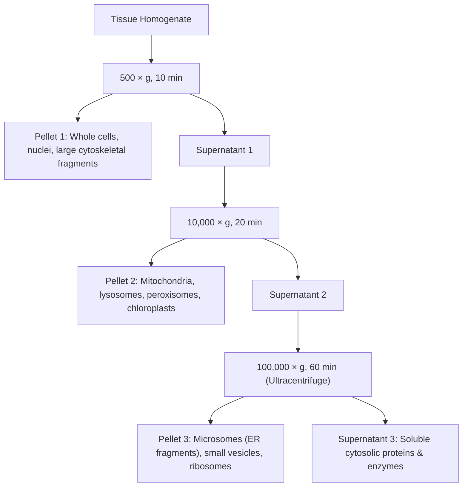

# 04 — Protein & Enzyme Recovery Techniques

**Module:** 04  
**Parent:** [[00_MOC_Prot_and_Enzyme|Index / MOC]] | **Previous:** [[03_Enzyme_Catalysis_and_Kinetics|03 — Enzyme Catalysis & Kinetics]]  
**Topics:** Downstream Processing, Activity-Centered Recovery Workflow (Release → Enrich → Condition), Cell Disruption & Tissue Pretreatment, Physical & Chemical Lysis, Detergent Chemistry, Centrifugation Mechanics, Differential Centrifugation, Density-Gradient Centrifugation, Ultrafiltration, Precipitation & Fractional Precipitation (organic solvents, ammonium sulfate, isoelectric), Other Precipitants

---

## 1. Downstream Processing Strategy: Activity-Centered Workflow

Enzyme recovery must be engineered around **preserving catalytic activity and native conformation**. Unlike small organic molecules, proteins are thermodynamically metastable macromolecular assemblies prone to denaturation, aggregation, autolysis, and proteolytic cleavage.



### The Three Operational Pillars:
1. **Release (Extraction):**
   * Disrupt cells using minimum necessary mechanical or chemical shear to prevent denaturation.
   * Suspend target in **protective extraction buffer**: controlled $\text{pH}$ (buffering at native optimum), osmolarity, ionic strength, reducing agents ($\text{DTT}$, $\beta$-mercaptoethanol to prevent non-native disulfide bridge crosslinking), protease inhibitors ($\text{PMSF}$, $\text{EDTA}$ for metalloproteases), and cryoprotectants/polyols (glycerol).
   * Promptly centrifuge or filter to separate soluble proteins from insoluble structural debris.
2. **Enrich (Gross Volume Reduction & Fractionation):**
   * Utilize cost-effective bulk enrichment: fractional salting-out ($(\text{NH}_4)_2\text{SO}_4$), organic solvent fractionation, or isoelectric precipitation.
   * Precipitate the target enzyme while keeping impurities soluble, or precipitate major contaminants first.
   * Redissolve the isolated target pellet in the **smallest practical volume** of buffer to maximize concentration and prepare a low-volume feed for high-resolution steps.
3. **Condition (Polishing Preparation):**
   * Desalt via dialysis, size-exclusion spin columns, or tangential flow filtration to remove high salt/precipitant concentrations.
   * Exchange into mobile phase buffer matching downstream chromatography (ion-exchange, affinity, hydrophobic interaction) or storage/cryopreservation formulation.
   * Clarifying microfiltration ($0.22\ \mu\text{m}$ or $0.45\ \mu\text{m}$) to protect chromatography resin beds from clogging.

---

## 2. Cell Disruption & Tissue Pretreatment

### 2.1 Mechanical & Biochemical Barriers by Sample Type

Different biological sources exhibit distinct cell wall and matrix compositions, demanding tailored disruption strategies to minimize sample heating and oxidative degradation:

| Sample Origin | Structural Barrier | Practical Pretreatment | Critical Control Parameters |
| :--- | :--- | :--- | :--- |
| **Animal Tissue** | Extracellular matrix ($\text{ECM}$), collagen/elastin fibers, adipose tissue | Mince / dice cold ($4^\circ\text{C}$); trim visible adipose/connective tissue; pre-homogenize in buffered medium | Prevent temperature spikes; avoid foaming/air entrapment (surface denaturation) |
| **Plant Tissue** | Rigid cellulose/hemicellulose wall, pectin, polyphenols, secondary metabolites | Snap-freeze; pulverize under liquid $\text{N}_2$; add Polyvinylpolypyrrolidone ($\text{PVPP}$) to adsorb polyphenols | Inhibit polyphenol oxidase ($\text{PPO}$); prevent phenolic oxidation and browning |
| **Yeast / Fungi** | Thick, cross-linked rigid wall ($\beta$-glucan, chitin, mannoproteins) | Enzymatic wall softening (lyticase/zymolyase) or high-shear bead milling | Reaction time; osmotic stabilizing support (sorbitol/sucrose) during spheroplast generation |
| **Bacteria** | Rigid peptidoglycan sacculus (thick in Gram-positive; thin + outer membrane in Gram-negative) | Centrifugal pellet harvest; wash to remove broth metabolites; homogeneous resuspension | Control cell biomass density; manage lysate viscosity (liberated genomic $\text{DNA}$) |

### 2.2 Cell-Free Protein Synthesis (CFPS) Preparation Pipeline

Cell disruption protocols also produce metabolically active, intact transcription-translation crude extracts for **cell-free protein synthesis (CFPS)** (*Vilkhovoy et al., 2020*):



---

## 3. Disruption Methodologies: Mechanisms & Engineering Parameters

```
┌─────────────────────────────────────────────────────────────────────────────┐
│                       Cell Disruption Methodologies                         │
├───────────────────────────────┬─────────────────────────────────────────────┤
│ Physical / Mechanical Methods │ Biochemical / Chemical Methods              │
├───────────────────────────────┼─────────────────────────────────────────────┤
│ • Mechanical Grinding         │ • Detergent-Mediated Chemical Lysis         │
│ • Ultrasonic Cavitation       │ • Enzymatic Wall Digestion (Lytic Enzymes)  │
│ • High-Pressure Homogenization│ • Osmotic Shock & Organic Solvents          │
└───────────────────────────────┴─────────────────────────────────────────────┘
```

### 3.1 Mechanical Grinding
* **Suitability:** Coarse, fibrous, or resilient tissue samples (skeletal muscle, plant leaves, roots, seeds).
* **Equipment:** Chilled mortar and pestle (with quartz sand or alumina abrasives), Waring blenders, Polytron rotor-stator homogenizers.
* **Operational Rules:**
  * Pulverize tissue frozen under liquid nitrogen ($\approx -196^\circ\text{C}$) to keep water glass-solid and shatter cell walls without enzymatic autolysis.
  * Pre-chill all metal/ceramic hardware to $4^\circ\text{C}$ or lower.
  * Operate in short bursts (10–15 s) with cooling intervals on ice to prevent local frictional heat buildup.

### 3.2 Ultrasonic Disruption (Sonication)
* **Physical Mechanism:** High-frequency electrical energy ($20\text{--}50\ \text{kHz}$) is converted via a piezoelectric transducer into mechanical acoustic vibrations:

$$\text{Acoustic Waves} \xrightarrow{\text{Rarefaction / Compression}} \text{Transient Microbubbles} \xrightarrow{\text{Violent Collapse}} \text{Cavitation Shear Force } (\tau > 10^3\ \text{MPa})$$

* **Cavitation Dynamics:**
  1. *Microbubble Formation:* Acoustic rarefaction cycles pull dissolved gases into microscopic cavities.
  2. *Cavitation Collapse:* When bubbles reach resonance size, compressive cycles cause violent collapse, generating microjets and localized shock waves.
  3. *Lysis:* Hydrodynamic shear stresses rip apart lipid bilayers and bacterial peptidoglycan envelopes, liberating intracellular contents.
* **Comparison of Sonication Modalities:**

| Modality | Direct Probe Sonicator | Cup Horn / Bath Sonicator | Covaris AFA (Adaptive Focused Acoustics) |
| :--- | :--- | :--- | :--- |
| **Contact Mode** | Direct probe insertion into tube | Indirect via water bath | Indirect acoustic focal lensing |
| **Energy Distribution** | High intensity at probe tip; sharp gradient | Diffuse acoustic intensity | Centered, focused high-density acoustic zone |
| **Aerosol / Cross-Contamination** | High risk; requires probe cleaning | Negligible; closed microtube | Zero risk; sealed isothermal vials |
| **Thermal Dissipation** | Intense localized heat at tip | Moderate heating of bath liquid | Strictly isothermal; refrigerated fluid circulation |

* **Protocol Imperatives:** Always sonicate in **pulsed mode** (e.g., 2–5 s ON, 5–10 s OFF) submerged in an ice-water slurry to prevent thermal denaturation.

### 3.3 Chemical Lysis & Detergent Chemistry
Detergents are amphiphilic surfactants that intercalate into biological membranes, solubilize lipid bilayers, and form mixed detergent-lipid-protein micelles.

```
       Detergent Monomers           Critical Micelle Conc. (CMC)          Mixed Micelles
   O====  O====  O====  O====   ───────────────────────────────►     ╭───────╮
    Lipophilic  Hydrophilic                                           │  MEMBRANE  │  + Solubilized
      Tail        Head                                                │  PROTEIN  │     Proteins
                                                                      ╰───────╯
```

#### Detergent Classification & Properties:

| Detergent Name | Class | Structure & Formula | Denaturing Strength | Operational Properties & Applications |
| :--- | :--- | :--- | :--- | :--- |
| **Triton X-100** | Non-ionic | $\text{C}_{14}\text{H}_{22}\text{O}(\text{C}_2\text{H}_4\text{O})_n$<br/>($n \approx 9\text{--}10$, octylphenol ethoxylate) | Mild / Non-denaturing | Disrupts lipid-lipid and lipid-protein interactions without breaking native tertiary protein folding. Ideal for isolating functional enzymes and membrane proteins. |
| **SDS** (Sodium dodecyl sulfate) | Anionic | $\text{CH}_3(\text{CH}_2)_{11}\text{OSO}_3^-\ \text{Na}^+$ | Strong denaturant | Binds polypeptide backbone stoichiometrically ($\approx 1.4\ \text{g SDS / g protein}$); linearizes polypeptide chains, masks intrinsic charge with uniform negative density. Destroys enzymatic activity (standard for SDS-PAGE). |
| **CHAPS** | Zwitterionic | Sulfobetaine steroid core<br/>(3-[(3-cholamidopropyl)dimethylammonio]-1-propanesulfonate) | Intermediate / Non-denaturing | Rigid steroid ring prevents deep hydrophobic chain denaturation. Retains native quaternary complexes and biological activity; easy to dialyze out due to high CMC ($\approx 8\ \text{mM}$). |

### 3.4 Enzymatic Lysis (Lytic Enzymes)
* **Mechanisms:** Specific biocatalytic cleavage of covalent glycosidic and peptidic bonds in outer rigid cell walls:
  * **Lysozyme (Muramidase):** Cleaves $\beta(1\to4)$ glycosidic bonds between $N$-acetylmuramic acid ($\text{NAM}$) and $N$-acetylglucosamine ($\text{NAG}$) in bacterial peptidoglycan.
  * **Zymolyase / Lyticase:** Cleaves $\beta(1\to3)$-glucan linkages in yeast (*S. cerevisiae*, *P. pastoris*) cell walls.
  * **Cellulase / Pectinase:** Hydrolyzes plant structural polysaccharides.
* **Trade-Offs:**
  * *Pros:* Gentle, zero mechanical shear, preserves labile enzyme complexes.
  * *Cons:* Kinetic latency (requires 15–60 min incubation), temperature trade-off ($25\text{--}37^\circ\text{C}$ vs $4^\circ\text{C}$ stability), cost, and introduction of a foreign protein impurity that must be removed downstream.

---

## 4. Centrifugation Mechanics & Downstream Separation

Centrifugation uses centrifugal acceleration to separate particles on the basis of size, shape, and buoyant density.

$$\text{RCF} = \frac{v^2}{r \cdot g} = \frac{(r\omega)^2}{r \cdot g} = \frac{r \cdot (2\pi \cdot \text{RPM} / 60)^2}{g} \approx 1.118 \times 10^{-5} \cdot r_{\text{cm}} \cdot (\text{RPM})^2$$

Where:
* $\text{RCF}$: Relative Centrifugal Force (expressed in units of $\times g$).
* $r_{\text{cm}}$: Rotational radius from central spindle to bottom/outer edge of tube ($\text{cm}$).
* $\text{RPM}$: Rotor angular velocity in revolutions per minute.

---

### 4.1 Rotor Geometries: Fixed-Angle vs. Swing-Out

```
     FIXED-ANGLE ROTOR (20°- 45°)                SWING-OUT (HORIZONTAL) ROTOR (90°)
     
        Before        Spinning                       Before              Spinning
       ┌──────┐       ┌──────┐                      ┌──────┐       ┌──────────────────┐
       │      │       │ \    │                      │      │       │                  │
       │      │   ►   │  \   │                      │      │   ►   │   Sedimentation  │
       │      │       │   \  │                      │      │       │   ───► ───►  ▓▓▓ │
       └──────┘       └───-──┘                      └──────┘       └──────────────────┘
                      Pellet on wall                               Pellet at tube bottom
```

| Parameter | Fixed-Angle Rotor | Swing-Out (Buckets) Rotor |
| :--- | :--- | :--- |
| **Rotor Orientation** | Tube slots machined at constant angle ($20^\circ\text{--}45^\circ$) | Buckets hang vertically at rest; swing to $90^\circ$ horizontal under centrifugal field |
| **Path Length ($r_{\max} - r_{\min}$)** | **Short:** Particles strike the outer wall rapidly and slide along the wall to the outer base | **Long:** Particles migrate through the full fluid column length |
| **Sedimentation Efficiency** | High efficiency (short sedimentation time, low $k$-factor) | Lower efficiency (longer transit time across long column) |
| **Pellet Morphology** | Smeared pellet along outer wall / corner; risk of resuspension during pour-off | Flat, compact pellet centered squarely at the bottom of the tube; clean supernatant decanting |
| **Primary Utility** | Rapid pelleting of cells, bacteria, homogenate debris, precipitates | Density gradient centrifugation (sucrose/CsCl), phase partition, deep-well microplates |

---

### 4.2 Differential Centrifugation (Subcellular Fractionation)

Differential centrifugation exploits sedimentation velocity differentials driven by organelle particle size and mass:



#### Step-by-Step Fractionation Protocol:
1. **Low Speed ($500 \times g$, 10 min):** Pellets unbroken intact cells, dense nuclei, and coarse debris.
2. **Medium Speed ($10,000 \times g$, 20 min):** Pellets larger organelles (mitochondria, chloroplasts, lysosomes).
3. **High/Ultracentrifugation ($100,000 \times g$, 60 min):** Pellets fragmented endoplasmic reticulum (microsomes) and polysomes. The remaining liquid phase is the **cytosol** containing soluble enzymes.

---

### 4.3 Density-Gradient Centrifugation

Sample is layered on top of a pre-formed gradient; particles migrate until they band. Fractions resolve by **sedimentation rate** (size and mass), not by pelleting.

* **Principle:** sucrose/glycol gradient (e.g. 15–30 %) separates by size and mass.
* **Benefits:** native state preserved; small sample volumes.
* **Requirements:** gradient maker, suitable tubes, **swing-out rotor** (§4.1 — the long fluid column is what lets bands form).

```
 (a) Fill gradient     (b) Load sample      (c) Spin           (d) Collect
   ┌ 15 % ┐           ▓▓ sample layer      ╭ band 1           pipette off
   │ 20 % │           ░░░ homogenate       ├ band 2           each band
   │ 25 % │           (applied by pipette) ├ band 3           from the top
   └ 30 % ┘ bottom                         ╰ pellet
```

(a) tube pre-filled with gradient → (b) sample applied on top with a pipette → (c) spin, sample resolves into distinct bands → (d) collect the resolved bands.

---

### 4.4 Centrifuge Classification Matrix

| Metric / Application | Low-Speed Benchtop | High-Speed Centrifuge | Ultracentrifuge / Micro-Ultra |
| :--- | :---: | :---: | :---: |
| **Maximum Speed ($\text{RPM} \times 10^3$)** | $5\text{--}10$ | $20\text{--}28$ | $100\text{--}150$ |
| **Maximum RCF ($\times 10^3\ g$)** | $5\text{--}7$ | $60\text{--}100$ | $800\text{--}900$ |
| **Rotor Chamber Environment** | Ambient / Refrigerated | Refrigerated ($4^\circ\text{C}$), sealed | High vacuum (eliminates rotor air friction), armored steel casing |
| **Pelleting: Bacteria / Yeasts** | **Yes** | **Yes** | (Yes — overkill) |
| **Pelleting: Animal & Plant Cells** | **Yes** | **Yes** | (Yes — overkill) |
| **Pelleting: Nuclei** | **Yes** | **Yes** | (Yes — overkill) |
| **Pelleting: Protein Precipitates** | Some (dense flakes) | **Most** | (Yes) |
| **Pelleting: Membrane Fractions** | Incomplete | Partial | **Yes** |
| **Pelleting: Ribosomes / Polysomes** | No | No | **Yes** |
| **Pelleting: Macromolecules / DNA** | No | No | **Yes** |
| **Pelleting: Viruses** | No | Partial / Large viruses | **Yes** |

*( ) = feasible, but impractical or non-standard due to cost and rotor wear.*

---

### 4.5 Centrifugal Ultrafiltration (Membrane Spin Columns)

Centrifugal filter devices (e.g., Amicon Ultra, Vivaspin) perform rapid concentration and desalting:

```
Step 1: Load Sample       Step 2: Centrifuge         Step 3: Discard Filtrate    Step 4: Recover Retentate
  ┌─────────────┐            ┌─────────────┐             ┌─────────────┐            ┌─────────────┐
  │ ░░░░░░░░░░░ │            │             │             │             │            │  Pipette    │
  │ [Dilute   ] │   ────►    │ [Retentate] │   ────►     │ [Retentate] │   ────►    │   Out       │
  │ [Protein  ] │            ├───═══════───┤             ├───═══════───┤            │  ░░░░░░░░   │
  ├───═══════───┤ (MWCO)     │   ░░░░░░░   │             │             │            └─────────────┘
  │             │            │             │             │             │             Concentrated
  │             │            │ [Filtrate]  │             │             │             Purified
  └─────────────┘            └─────────────┘             └─────────────┘             Protein
```

* **Principle:** A semi-permeable membrane with a defined **Molecular Weight Cut-Off (MWCO)** (e.g., 3 kDa, 10 kDa, 30 kDa, 100 kDa) retains molecules larger than the pore rating while allowing solvent, salts, and small peptides to pass through.
* **Golden Rule of MWCO Selection:** Select a membrane with a MWCO rating **at least 2 to 3 times smaller** than the molecular weight of the target protein to guarantee $>95\%$ retention:

$$\text{MWCO}_{\text{optimal}} \le \frac{\text{MW}_{\text{target}}}{3}$$

* **Application in Dialysis Alternative:** Centrifugal diafiltration accomplishes buffer exchange in 2–3 wash cycles without the prolonged diffusion delays of dialysis tubing.

---

## 5. Precipitation & Fractional Precipitation (2.1.3)

**Precipitants strip the hydration shell.** Soluble proteins are stabilised by charged surfaces and a hydration layer. Precipitants remove water or neutralise charge, so protein–protein interactions dominate and aggregates form.

```
  Hydrated protein                     After precipitant
  ╭──────────╮  ← H₂O shell           ╭──────────╮
  │ protein  │  ← surface charge       │ protein  │   water removed / charge neutralised
  ╰──────────╯                         ╰──────────╯
      stays dissolved                      protein–protein contact → aggregate → precipitate
```

### 5.1 Precipitant 1 — Organic Solvents

Ethanol or acetone, always cold.

| Solvent | Ratio | Temperature |
| :--- | :--- | :--- |
| **Ethanol** | 3 volumes ice-cold ethanol : 1 volume sample | ≤ 4 °C, ideally ≤ −5 °C |
| **Acetone** | 4 volumes acetone : 1 volume sample | Pre-chill to −20 °C |

* **Risk:** organic solvents readily denature proteins.

### 5.2 Precipitant 2 — Ammonium Sulfate (AS)

**Gentle, cheap, selective** — the standard salting-out agent.

| | Property |
| :--- | :--- |
| **EFFECTIVE** | Most proteins precipitate at full saturation (~4 M) |
| **PRACTICAL** | No heat on dissolving; low density (1.25 g/cm³) eases centrifugation |
| **PROTECTIVE** | Non-denaturing and bacteriostatic |
| **SELECTIVE** | Proteins precipitate at different % saturation → fractional precipitation |

* **Example:** serum + 0.8 M AS precipitates **fibrinogen**; raising to 2.4 M precipitates **serum albumin**.
* **Salting out — ions compete for water:** in plain water the proteins stay hydrated; at high AS concentration NH₄⁺ and SO₄²⁻ sequester water molecules, exposed hydrophobic patches associate, and the proteins precipitate.
* **Reference table:** grams of AS per litre (20 °C) to go from an initial saturation to a target saturation — rows are initial %, columns are target %. Anchors: 0 → 20 % = 114 g/L, 0 → 100 % = 767 g/L (full table on the slide).
* **In this module:** [[lab/Supplementary|S2 — Ammonium sulfate saturation]] gives the volume equation $V_{\text{salt}} = V_0 \frac{S_2 - S_1}{1 - S_2}$ and the empirical endpoint (add salt a few grains at a time until dry crystals remain).

### 5.3 Precipitant 3 — Isoelectric Precipitation

**At pH = pI, solubility is minimal.**

* Net charge is zero at pI; pH > pI → net negative; pH < pI → net positive.
* At pI there is **no electrostatic repulsion** between molecules, so they aggregate.
* Precipitation is **slow and incomplete**.
* **Least denaturing** of all the methods.
* Solubility (mg/mL) against pH shows a sharp minimum at pI.

### 5.4 Other Precipitants

Mechanisms are read from the slide's diagram, not the table text — check the wording against the slide.

| Precipitant | Mechanism | Effect |
| :--- | :--- | :--- |
| **Polyethylene glycol (PEG)** | Neutral polymer excludes water | Often retains activity |
| **Protamine sulfate** | Basic peptide binding | Mild |
| **Heavy metal salts** (e.g. Hg²⁺) | Cross-linking | Denaturing |
| **Trichloroacetic acid (TCA)** | Strong-acid precipitation | Denatured |

**Choose by the need to keep activity:** TCA is for **analysis only**, never for active protein.

---

## Related

* [[00_MOC_Prot_and_Enzyme|MOC — Protein & Enzyme]]
* [[03_Enzyme_Catalysis_and_Kinetics|03 — Enzyme Catalysis & Kinetics]]
* [[lab/LAB_PROTOCOL_Sweet_Potato_Amylase_Purification_and_Activity_Assay|Lab — Sweet Potato Amylase]] — the 70 % saturation cut in practice